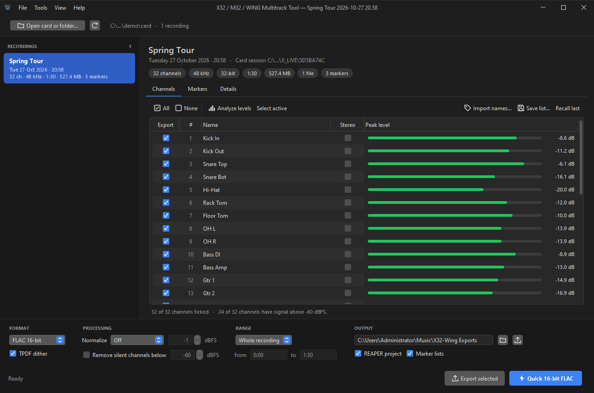
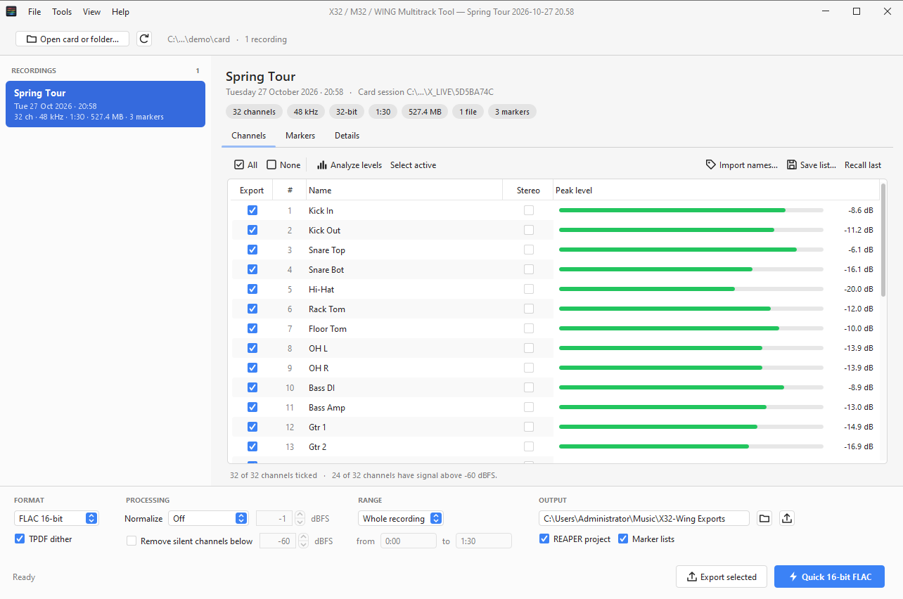
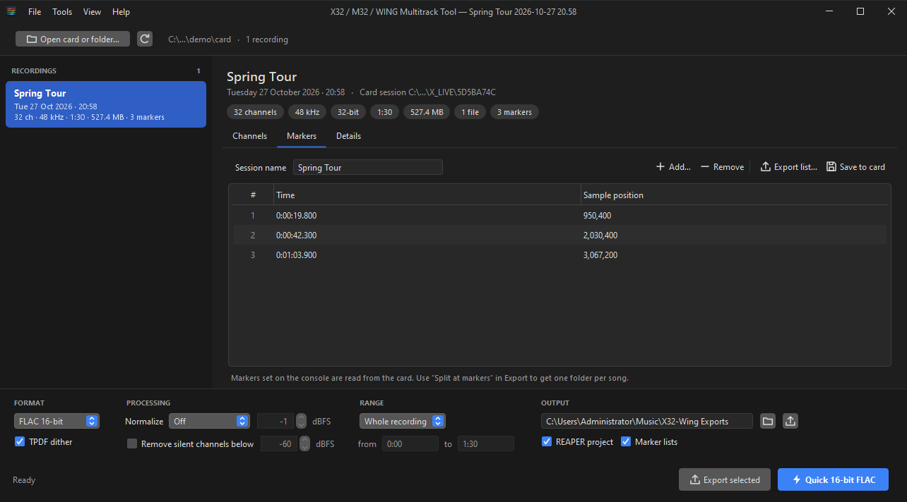

<div align="center">


# X32 / M32 / WING Multitrack Tool

**Turn Behringer X-Live and WING-LIVE SD card recordings into clean, named per-track files in a single click.**

[](https://github.com/Audbol/x32-wing-multitrack-tool/releases/latest)
[](https://github.com/Audbol/x32-wing-multitrack-tool/releases)
[](#download)
[](LICENSE)



</div>

## Why

The X32/M32 X-Live card and the WING-LIVE card record every input into a single multichannel
32-bit WAV, chopped into 4 GB pieces. A three-hour show is about 70 GB in 17 files, with every
unused input recorded as well. This tool turns that into what you actually want:

- One **FLAC or WAV per instrument**, named like your console's channels.
- The **unused channels left out**.
- Levels **normalized** if you want them.
- A **REAPER session** ready to mix, with the show's markers.

The X-Live take files are read as one continuous recording, so there are no gaps or clicks between them.

## Download

| | |
|---|---|
| **[Windows installer](https://github.com/Audbol/x32-wing-multitrack-tool/releases/latest)** `X32WingTool-x.y.z-Setup.exe` | Recommended. Includes its own Java runtime, so there's nothing else to install. Adds Start-menu and optional desktop shortcuts, can add the `x32wing` command to your PATH, and uninstalls cleanly. |
| Portable zip `X32WingTool-x.y.z-portable-win64.zip` | The same app with nothing to install. Unzip and run `X32WingTool.exe`. |
| Jar `X32WingTool-x.y.z.jar` | macOS and Linux, or any OS with Java 17+: `java -jar X32WingTool-x.y.z.jar` |

The installer isn't code-signed yet, so Windows SmartScreen may warn on first run. Click **More info → Run anyway**.
Every release includes `SHA256SUMS.txt` so you can verify the downloads.

## Quick start

1. Put the SD card in your computer and start the app.
2. Click **Open card or folder…** and pick the card. You can also drag it onto the window.
3. Pick a recording, then click **Quick 16-bit FLAC**.

Want named files? Click **Import names…** and choose your console scene (`.scn`) or snapshot
(`.snap`). Want to skip the empty inputs? Tick **Remove silent channels**.

## Features

<table>
<tr><td width="50%" valign="top">

**Export**
- FLAC 16/24-bit or WAV 16/24/32-bit float. Files over 4 GB are written as RF64 automatically.
- TPDF dither when reducing bit depth. Digital silence stays exactly silent.
- **Normalize** each file to a target peak, or apply one gain to all files so the mix balance is kept.
- **Remove silent channels** below a threshold you set, at no extra cost.
- Stereo pairs, per-channel selection, split at markers (one folder per song), or any time range.
- Writes a REAPER project, CSV and Audacity marker lists, and an export report.

</td><td width="50%" valign="top">

**Card management**
- Reads `SE_LOG.BIN`: session name, date, markers and take list.
- Edit the name and markers and save them back to the card, with a backup of the original.
- Imports channel names from an X32/M32 scene, a WING snapshot or a text list.
- **Combine WING card A and card B** into one 64-channel recording.
- **Repair** recordings left unfinalized when the card was pulled or the power failed.
- **Build a card session** from WAV or FLAC files for Virtual Soundcheck.

</td></tr>
</table>

Built-in FLAC encoder and decoder: there's no ffmpeg to install. It converts about **80× realtime**
from a local disk; reading straight off an SD card, the card reader is usually the limit.
The app follows your Windows light/dark setting, or you can pick one under **View**.

<div align="center">


</div>

## Command line

The installer can put `x32wing` on your PATH. It's handy for batch jobs and scripts.

```
x32wing scan E:\
x32wing flac E:\ -o D:\Shows --remove-silent --normalize linked
x32wing export E:\X_LIVE\5D5B9BDB --format wav24 --split-markers --stereo 17-18 --names show.scn
x32wing export E:\ --session 2 --from 1:02:00 --to 1:07:30
x32wing build E:\ ch01.flac ch02.flac ... --name "Soundcheck" --markers 3:20,7:45
x32wing repair E:\
x32wing selftest
```

Run `x32wing help` for every option.

## Verified

- **Real card:** an X32 X-Live recording (3h16m, 32 channels, 17 takes, 67.6 GB). Exports straddling
  the take boundaries, and the final seconds of the show, are **bit-identical to the raw card data**,
  checked with an independent reader.
- **Independent decoder:** REAPER decodes the exported FLAC files bit-identically.
- **Self-test:** `x32wing selftest` builds a 32-channel card session and checks every export option,
  header repair, card rebuilding, `SE_LOG.BIN` editing and name import.

## How the card format works

X-Live sessions live in `X_LIVE\<8 hex digits>\`, and the folder name is the start date/time.
Inside are the take files, **numbered in hex** (`…09.WAV`, `…0A.WAV` … `…0F.WAV`, `…10.WAV`).
Each is 32-bit PCM with 8, 16 or 32 interleaved channels. Audio starts at byte 32768, and each
take holds at most 0xFFFF0000 bytes of audio.

`SE_LOG.BIN` (2048 bytes) holds:
- session id, channel count and sample rate,
- take count and the size of each of up to 256 takes,
- total length,
- up to 125 marker positions (in samples),
- the session name, at byte offset 1552.

The WING-LIVE card is assumed to use the same layout. Scanning doesn't depend on that, because
every WAV header is read directly.

Standard FLAC holds at most 8 channels per file, which is one reason exports are per track.

**Speed tip:** with a slow card reader (the one tested here manages 18 MB/s, about an hour per
3-hour show), copy the session folder to a local disk before a **normalized** export. Normalizing
needs two reads; every other export needs one.

## Building from source

You need a JDK 17+ (jpackage ships with it) and, for the installer, [Inno Setup 6](https://jrsoftware.org/isinfo.php).

```
.\build.ps1             # dist\X32WingTool-<ver>.jar
.\build.ps1 -Exe        # + dist\X32WingTool\  (self-contained app)
.\build.ps1 -Installer  # + Setup.exe
.\build.ps1 -Release    # everything + portable zip + SHA256SUMS.txt
```

The build downloads FlatLaf from Maven Central on first run and checks it against a pinned SHA-256.
The version number lives in `src/x32wing/Main.java`, and `tools/MakeIcon.java` generates the icon.

## Credits

- The `SE_LOG.BIN` layout comes from Patrick-Gilles Maillot's [X32 tools](https://github.com/pmaillot/X32-Behringer).
- The look and feel is [FlatLaf](https://www.formdev.com/flatlaf/) (Apache-2.0). See [THIRD-PARTY-NOTICES.md](THIRD-PARTY-NOTICES.md).
- Behringer, X32, M32 and WING are trademarks of their respective owners. This project is not affiliated with or endorsed by Behringer.

## License

[MIT](LICENSE)
